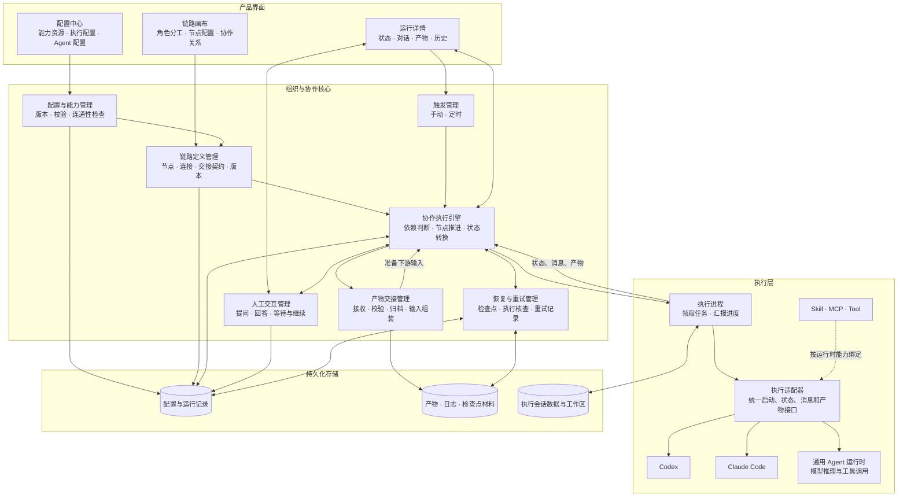
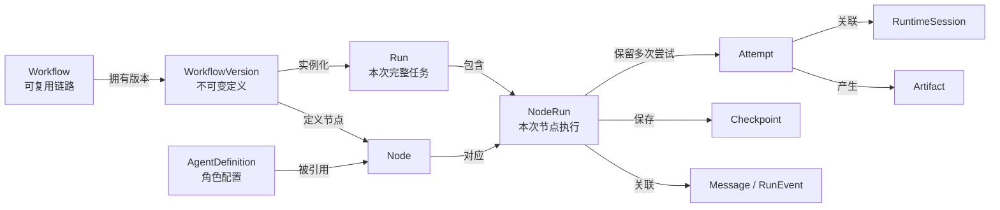
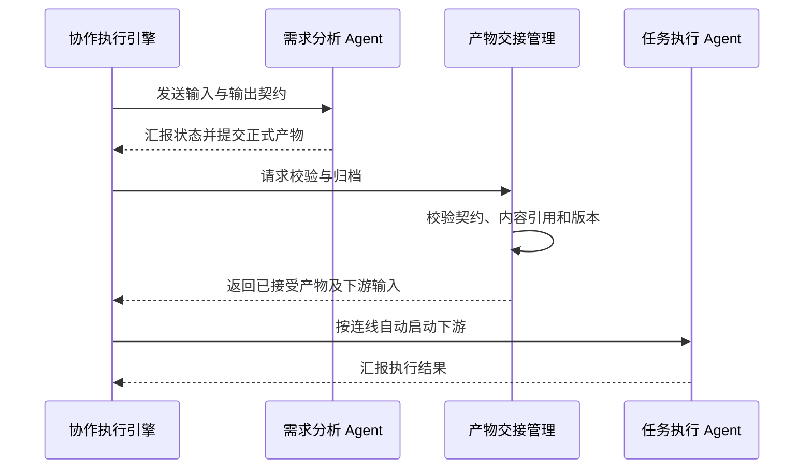
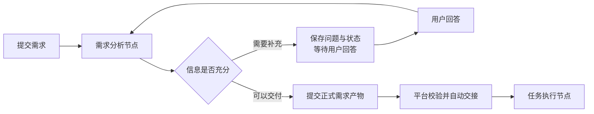
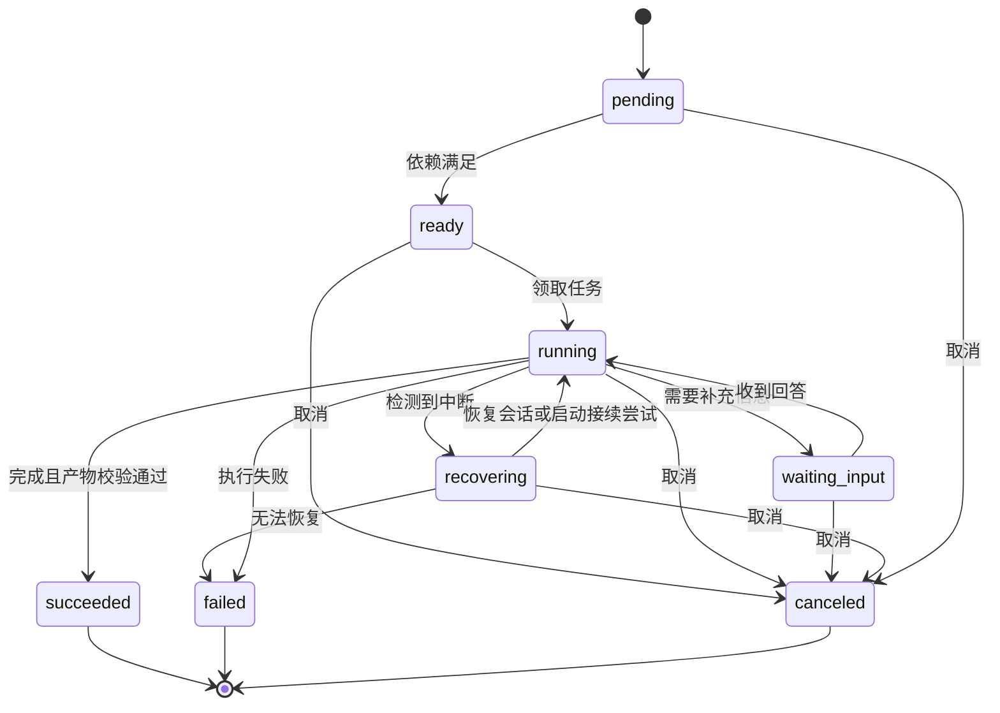

# AsomForge：项目说明、系统架构与核心概念

> 版本：v0.1 讨论稿  
> 日期：2026-11-19  
> 文档范围：产品定位、第一版范围、逻辑架构、核心概念与运行机制。  
> 说明：本文整理已确认需求，并提出必要的架构建议；不确定编程语言、框架、数据库产品及部署工具，不作为已经批准的实现方案。

## 1. 项目是什么

**AsomForge 是一个 Agent 组织与协作平台。**

用户定义不同职责的 Agent，为其配置能力，在画布上建立协作链路。平台按照用户定义的协作关系运行任务，管理执行状态，处理消息与人工补充，并按照约定的格式在 Agent 之间交接产物。

“组织”在第一版中具体体现为：角色、职责、能力绑定和协作关系。用户负责定义分工；平台负责按定义推进工作。

多执行环境接入是平台的支撑能力。Codex、Claude Code、通用 Agent 运行时等可以承载不同角色的执行，但不会成为产品定位的主体。

### 1.1 为什么做

单个 Agent 可以完成某一项工作，但将多个角色连接成可重复执行的协作过程，还需要解决：

- 角色与能力配置能够复用。
- 协作关系可以在界面上创建和修改。
- 上下游采用明确、可校验的产物格式进行交接。
- 需求不明确时，能够向用户提问并继续原任务。
- 一条链路能够重复运行，每次运行有独立状态和可追溯记录。
- 执行中断后，可以利用已保存的状态与检查点恢复或重试。

AsomForge 将这些能力统一为一个可配置、可运行、可观察的平台。

### 1.2 典型场景

**开发协作：** 用户创建需求分析 Agent 和任务执行 Agent，分别选择 Codex、Claude Code 作为执行环境。需求分析产出结构化说明和任务清单，平台校验后交给任务执行 Agent。

**工具型任务：** 用户创建巡检 Agent，为其绑定 MCP 能力。Agent 通过模型理解任务，调用 MCP 获取平台状态并形成报告。此类任务不要求绑定开发工具。

上述场景使用相同的任务、产物、状态与交接模型。

## 2. 第一版范围与原则

### 2.1 已确认的需求

| 领域 | 第一版方向 |
| --- | --- |
| 产品入口 | 配置中心和执行页面；执行页面包含链路画布与运行详情 |
| 配置管理 | 管理 Skill、MCP、Tool、执行环境配置和 Agent 配置 |
| 配置校验 | 支持适用的基础校验和连通性检查，例如 MCP 连接检查 |
| 协作方式 | 用户在画布上创建 Agent 节点并定义协作关系 |
| 执行方式 | 支持手动启动和定时启动，共用运行机制 |
| 平台交接 | 平台自动接收、校验、保存上游产物，并构造下游输入 |
| 人工交互 | 需求不明确时提问，等待回答后继续处理 |
| 运行管理 | 保存状态、执行历史、产物与恢复所需信息 |
| 运行方式 | 支持本机运行和服务器部署，使用一致的领域模型 |
| 长期记忆 | 第一版不建设跨任务的长期记忆系统 |
| 技术选型 | 在产品与架构讨论后另行确定 |

### 2.2 第一版不包含的内容

- Agent 自行创建协作节点、改变画布结构或将工作自主分派给新 Agent。
- 跨任务自动积累和检索经验的长期记忆系统。
- 组织层级、职位体系等独立的组织管理功能。
- 对任意运行时承诺逐条工具调用或进程内部状态的精确恢复。

需求分析 Agent 可以生成任务清单；该清单是交付物，不会自动变成新的画布节点。

### 2.3 设计原则

1. **用户定义协作，平台管理执行。** 协作执行引擎按图推进，不承担自主规划角色。
2. **定义与运行分离。** 配置可以复用，每次执行独立记录。
3. **正式产物驱动交接。** 对话记录、过程日志和正式交付物分别管理。
4. **状态持久化。** 页面展示和执行进程内存都不是运行事实的唯一来源。
5. **恢复能力有边界。** 优先复用有效会话，否则利用检查点重新发起执行。
6. **逻辑职责先确定。** 模块划分不意味着第一版必须拆成多个服务。

## 3. 方案取舍与当前结论

| 方案 | 特点 | 当前结论 |
| --- | --- | --- |
| 用户配置的显式协作链路 | 角色与连接关系清楚，执行过程容易追踪 | 用户已明确选择，作为第一版主体 |
| Agent 自主建立分工与协作关系 | 灵活，但需要额外控制自主规划与分派 | 不纳入第一版 |
| 显式链路中嵌入自主分派节点 | 兼顾灵活性，但增加节点生成与运行管理复杂度 | 暂不纳入第一版 |

**架构建议，待确认：** 使用统一的协作核心、可插拔执行适配器和持久化运行模型；本机与服务器运行复用同一套核心。首版不要求远程执行节点管理。

## 4. 总体逻辑架构



### 4.1 各模块的职责

| 模块 | 职责 |
| --- | --- |
| 配置与能力管理 | 管理可复用配置，记录版本，检查配置与连接是否可用 |
| 链路定义管理 | 保存画布结构、节点设置、连接关系及输入输出契约 |
| 触发管理 | 将手动请求、定时触发转为新的运行实例 |
| 协作执行引擎 | 根据依赖与状态决定哪个节点可以执行，推进已定义的链路 |
| 产物交接管理 | 校验上游正式产物，保存可追溯版本，构造下游输入 |
| 人工交互管理 | 将 Agent 的问题关联到具体运行与节点，保存回答并继续任务 |
| 恢复与重试管理 | 核查中断执行，选择会话恢复或检查点重试，保留每次尝试 |
| 执行进程 | 领取任务、启动执行适配器、汇报进度与结果 |
| 执行适配器 | 将不同运行时的行为转换为平台统一的任务、消息、状态和产物 |
| 持久化存储 | 保存定义、运行事实与恢复材料，支撑历史查询和恢复 |

### 4.2 运行方式

本机运行与服务器部署共用上述逻辑架构。界面层、协作核心和执行层保留清晰边界，但第一版允许它们运行于同一台机器。

具体安装形式、进程组织、存储产品与部署工具，留待技术选型阶段讨论。

## 5. 核心概念

### 5.1 配置与协作定义

| 概念 | 定义 | 示例 |
| --- | --- | --- |
| Agent 定义（AgentDefinition） | 可复用的角色配置，描述职责、指令、执行方式及能力绑定 | 需求分析 Agent |
| 执行环境（Runtime） | 实际承载 Agent 推理与行动的运行系统 | Codex、Claude Code、通用 Agent 运行时 |
| 执行配置（RuntimeProfile） | 某个执行环境所需的配置集合 | 模型、启动参数、凭据引用、工作目录规则 |
| 执行适配器（Adapter） | 连接平台与某类运行时的程序模块 | 将 CLI 输出转换成平台事件的适配器 |
| Skill | 可复用的做事方法、规则或指令材料 | 需求分析规范、开发规范 |
| Tool | 执行具体操作的可调用能力 | 文件读取、HTTP 请求 |
| MCP 连接 | 通过 MCP 访问工具与资源的连接配置 | 平台状态查询服务 |
| 协作链路（Workflow） | 可重复执行的一套协作定义，是画布组织结果的业务载体 | 需求到开发链路 |
| 链路版本（WorkflowVersion） | 某次发布的不可变协作定义 | 开发链路 v1 |
| 节点（Node） | 链路中对某个 Agent 定义的使用及本节点的特定配置 | 使用需求分析 Agent，要求输出指定需求格式 |
| 连接（Edge） | 节点之间的依赖关系及产物交接规则 | 分析完成后将需求包交给开发节点 |
| 交接契约（HandoffContract） | 上下游约定的产物结构、版本和校验要求 | 需求交接契约 v1 |

Agent 定义和画布节点不同：同一个 Agent 定义可以被多个链路引用，也可以在同一链路中被多次使用，各节点具有不同输入或配置。

MCP 提供工具和资源访问能力，本身不执行推理循环。工具型 Agent 仍需要模型与运行时承载任务理解和工具调用。

### 5.2 运行与持久化

| 概念 | 定义 | 作用 |
| --- | --- | --- |
| 运行实例（Run） | 一条链路针对某份输入实际执行一次的记录 | 区分不同任务，保存本次执行全貌 |
| 节点运行（NodeRun） | 某个节点在某次 Run 中的执行记录 | 保存该节点的输入、状态、产物和消息 |
| 执行尝试（Attempt） | 节点运行的一次实际执行尝试 | 区分初次执行、重试和接续执行的过程 |
| 运行时会话（RuntimeSession） | 执行环境自己的会话及其引用 | 支持节点内部的多轮处理和适用的会话恢复 |
| 消息（Message） | 一次指令、问题、回答或说明 | 支持交互，不默认等同于正式产物 |
| 产物（Artifact） | 节点正式提交的交付结果 | 作为下游输入与历史追溯依据 |
| 内容部分（Part） | 消息或产物中的文本、结构化数据或文件内容 | 承载具体交换内容 |
| 检查点（Checkpoint） | 某个已保存执行进度及其恢复材料引用 | 供中断恢复和重试使用 |
| 运行事件（RunEvent） | 带有时间和来源的执行事实 | 记录状态变化、交接及执行尝试 |
| 工作区（Workspace） | 执行时使用的文件与项目环境 | 保存项目文件和实际工作结果 |

**“任务”存在层级差异：** 平台通常把用户提交的一整项工作表示为 Run；A2A Task 则是一次 Agent 交互中的工作单元。一个 Run 可以包含多个节点、执行尝试和 A2A Task，两者不应直接等同。

### 5.3 核心关系图



## 6. 链路、运行实例与历史记录

### 6.1 每次启动创建新的 Run

链路本身是模板。每次手动启动或定时触发，都在该链路下创建一个新的 Run，而不是清空旧状态后覆盖执行。

```text
开发协作链路
├── v1：需求分析 → 任务执行
│   ├── Run 001：增加登录功能
│   └── Run 002：修复导出问题
└── v2：需求分析 → 任务执行 → 结果检查
    └── Run 003：增加报表功能
```

每个 Run 固定引用链路版本，并保存本次输入、有效节点配置、能力与运行配置版本引用、触发来源和工作区信息。

配置快照保存业务配置及凭据引用，不将明文密钥复制到运行历史。精确复现还取决于外部模型、工具和文件版本是否仍可用。

### 6.2 历史可追溯

至少能够查询：

- 使用了哪条链路、哪个版本，何时及为何启动。
- 每个节点的状态变化、问题与回答。
- 每次执行尝试的输入、结果和失败原因。
- 正式产物的版本、来源及下游使用记录。
- 检查点、恢复方式以及恢复后产生的尝试。

运行历史用于追溯，不会自动全部注入下一次任务的模型上下文。

### 6.3 下一次任务的会话

**建议：** 每个新 Run 中的节点默认创建新的运行时会话。需要延续旧工作时，显式引用先前的产物或关联运行记录。

同一 Run 中的澄清对话可以继续原节点会话。发生重试时，可在运行时支持且语义合适的情况下复用会话，也可新建会话并读取恢复材料。

工作区可以复用，但应记录起始版本及已有改动；工作区的文件状态与模型的对话上下文分别管理。

## 7. 产物交接与 A2A

### 7.1 A2A 的位置

A2A 提供 Agent 间任务、消息、状态和产物的通用通信模型。AsomForge 定义组织中的协作关系、业务产物契约和推进规则。

| 责任 | 归属 |
| --- | --- |
| 定义谁与谁协作 | 用户在画布上配置 |
| 定义消息、Task、Artifact 等通用通信结构 | 参考或接入 A2A |
| 定义需求说明等业务产物格式 | AsomForge 的交接契约 |
| 保存产物版本和关联关系 | AsomForge |
| 根据连接关系启动下游 | AsomForge 协作执行引擎 |
| 调用 MCP 工具与资源 | Agent 的执行运行时 |

A2A Agent Card 中的 skill 是对能力的描述，与配置中心管理的 Skill 指令材料是不同概念。

**建议：** 内部统一任务、消息和产物模型，并由适配器对接运行时。是否首版完整实现 A2A 标准接口、使用哪个协议版本，另行讨论。采用类似字段并不意味着已经符合 A2A 标准。

### 7.2 默认交接过程



交接成立需要满足：上游执行已完成，必需产物齐备，契约校验通过，相关文件能够被下游访问。

格式不合法或必需材料缺失时，不启动下游；记录原因，再根据节点配置进入修正或失败处理。

结构校验不能证明业务内容正确。语义验收通过节点的完成要求、校验规则或用户配置的评审步骤实现。

### 7.3 需求交接契约示例

| 字段 | 内容 |
| --- | --- |
| 契约标识与版本 | 指明产物采用的业务结构 |
| 目标与范围 | 本次需求要解决的问题与功能边界 |
| 验收条件 | 判断结果是否符合要求的条件 |
| 任务清单 | 具体工作与必要的依赖说明 |
| 相关材料 | 文档、代码版本、文件和其他资源引用 |
| 假设与未决事项 | 已采用的假设及仍需处理的问题 |

上述字段为示例，最终字段与校验强度待契约设计阶段确认。第一版建议提供默认契约，减少手工映射工作。

不同 Agent 的 A2A contextId、taskId 和运行时 session ID 分别保存映射；不能假设一个上下文标识能跨所有 Agent 共享会话。

## 8. 人工交互机制

需求不明确时，节点提交问题并进入等待输入状态，平台记录问题所属的 Run、NodeRun 和当前会话。用户在运行详情中回答后，平台保存回答，并继续对应节点。



等待输入可以作为 Agent 节点的运行状态，不强制要求每个问题对应一个额外画布节点。正常产物交接默认自动推进。

## 9. 状态保存、检查点与断点重试

### 9.1 状态机作用于运行对象

Agent 定义描述角色，不承载某次任务的执行状态。Run 保存整条链路的总体状态，NodeRun 保存节点状态，Attempt 记录实际执行尝试。

建议的节点状态如下：

| 状态 | 含义 |
| --- | --- |
| pending | 等待依赖满足 |
| ready | 已具备输入，等待领取 |
| running | 正在执行 |
| waiting_input | 等待用户提供信息 |
| recovering | 正在核查中断并准备恢复 |
| succeeded | 执行完成，正式产物已被接受 |
| failed | 当前节点执行失败 |
| canceled | 已取消 |



此图描述单次节点推进过程。失败后的显式重试必须保留旧失败事件和旧 Attempt，再创建新 Attempt，NodeRun 聚合状态随重试更新；不把旧尝试改写成成功。

平台状态不等同于 A2A Task 状态。已进入终态的 A2A Task 不重新打开，继续工作时创建新的关联 Task。

### 9.2 保存什么

| 保存对象 | 关键内容 |
| --- | --- |
| Run | 链路与配置版本、本次输入、触发来源、总体状态 |
| NodeRun | 节点输入引用、已接受产物、当前状态、待回答问题 |
| Attempt | 执行进程归属、开始结束时间、会话引用、错误与恢复来源 |
| Checkpoint | 已完成事项、待办、关键决策、进度说明及相关文件版本 |
| 事件记录 | 状态变化、交接、重试和人工回答的时间与来源 |

检查点不是对内存或模型内部状态的完整快照。检查点只能记录运行时能够提供、且平台实际保存的进度。

### 9.3 恢复顺序

1. 核查原执行是否仍在进行，避免重复启动。
2. 原执行仍有效时，重新关联并获取进度。
3. 原执行已结束但会话可恢复时，通过适配器继续会话。
4. 会话不可恢复时，利用检查点、正式产物和当前工作区状态创建新 Attempt。
5. 恢复材料不足或外部操作结果不确定时，记录具体原因，进入失败或待人工处理状态。

第一版建议保证节点之间的持久化续跑，并根据运行时能力提供节点内部恢复。已完成且产物有效的上游节点不必因下游中断而重跑。

### 9.4 一致性要求

- 状态变化需要持久化，并校验当前执行归属，避免过期执行覆盖新执行结果。
- 正式产物先可靠保存，再将产物接受记录、节点完成状态和下游待执行记录作为一致的提交单元。
- 调度与领取需要去重；执行进程使用任务归属与心跳等机制识别失联执行。
- 重试不代表外部操作可以任意重放。对于可能重复创建或修改资源的操作，使用幂等标识或先核查结果。
- 保存会话标识之外，还应保留会话数据和工作区的有效引用。文件恢复依赖实际存在的文件版本或快照。

这些要求定义运行可靠性的目标，不预先指定事务、队列或工作流引擎产品。

## 10. 数据保存与上下文管理

### 10.1 逻辑存储分类

| 存储类别 | 保存内容 |
| --- | --- |
| 配置与运行记录存储 | 配置版本、链路版本、Run、NodeRun、Attempt、消息、事件、产物索引 |
| 文件与产物存储 | 文档、附件、大体积日志、检查点材料和产物版本 |
| 执行环境数据 | 运行时会话文件、工作区、中间结果及适用的文件快照 |

**建议：** 采用关系型持久化模型保存定义与运行记录，大体积内容通过文件引用关联。具体产品、存放位置与备份方式在技术选型阶段确定。

### 10.2 第一版的上下文边界

第一版不建设长期记忆，但保存完成当前任务、恢复执行及历史追溯所需的数据。

| 概念 | 用途 | 第一版处理 |
| --- | --- | --- |
| 运行历史 | 解释发生了什么 | 保存并可查询 |
| 任务内上下文 | 支持当前节点完成任务 | 按需构造与更新 |
| 恢复材料 | 支持检查点恢复和重试 | 保存可用进度与材料 |
| 跨任务长期记忆 | 自动复用经验与偏好 | 不建设 |

### 10.3 上下文过长的处理

- 节点内部优先使用运行时支持的上下文压缩与会话管理机制，由适配器声明能力。
- 通用 Agent 运行时需要平台自行实现上下文预算、摘要和工具输出控制。
- 节点之间以正式产物和必要上下文交接，不默认传递上游全部对话。
- 验收条件、关键约束和已确认回答独立保存，必要时重新提供，不能只依赖压缩后的摘要。
- 大体积材料保存为文件，按需读取相关片段。
- 新 Run 默认不自动继承旧 Run 的对话；底层运行时自身的跨任务记忆应显式配置，避免无意引入隐式历史。

不同运行时对压缩、恢复和会话保留的支持不同，需在实际接入时验证。

## 11. 完整示例

用户创建“需求分析 → 任务执行”链路：

1. 在配置中心准备需求分析 Agent 与任务执行 Agent，分别选择执行环境和可用能力。
2. 在画布中创建两个节点，建立连接，选择需求交接契约并发布链路版本。
3. 提交需求后，平台创建 Run 及其 NodeRun，固定本次有效配置。
4. 执行进程启动需求分析节点；需要澄清时保存问题并等待回答。
5. 用户回答后继续分析，Agent 提交需求说明和任务清单。
6. 平台校验、保存产物，并创建下游待执行记录。
7. 任务执行节点读取正式需求产物，在工作区完成任务。
8. 中断时按检查点机制恢复或重试，保留旧尝试及恢复来源。
9. 所有必需节点完成后，Run 标记成功，保留全过程和最终产物。
10. 下一次提交需求时，在同一链路下创建新 Run。

## 12. 建议、待讨论事项与后续工作

### 12.1 本文提出、尚待确认的架构建议

- 统一协作核心，执行环境通过适配器接入。
- 使用版本化定义、独立 Run、NodeRun 和 Attempt 管理运行。
- 采用关系型运行记录和文件产物引用的持久化方式。
- 新 Run 默认新建节点会话，跨任务通过显式产物引用延续。
- 默认提供常用交接契约。
- 节点间可靠续跑，节点内按运行时能力恢复。

### 12.2 技术与详细行为待讨论

| 事项 | 后续需要确定的内容 |
| --- | --- |
| 技术栈 | 前后端语言、框架及打包形式 |
| 持久化 | 数据库产品、文件存储实现、备份与保留策略 |
| 执行接入 | Codex、Claude Code 的接入方式、版本与能力验证 |
| A2A | 实现范围、协议版本及外部 Agent 接入时机 |
| 画布能力 | 首版是否包含条件分支、并行汇合、显式循环等能力 |
| 重试规则 | 次数、触发条件及自动与人工重试边界 |
| 多用户边界 | 独立安装使用与同一实例多人协作的范围，及对应隔离要求 |
| 工作区 | 复用规则、版本记录、并发写入约束 |
| 操作界面 | 画布、运行详情、对话与产物查看的具体布局 |

以上属于后续设计议题，不在本文中默认确定。本文批准后，仍需先完成必要的技术讨论，再编制具体实现计划。

## 13. 参考资料

- [A2A 核心概念](https://a2a-protocol.org/latest/topics/key-concepts/)：Task、Message、Part、Artifact 和 Agent Card。
- [A2A 任务生命周期](https://a2a-protocol.org/latest/topics/life-of-a-task/)：上下文、多轮输入、任务终态和产物关联。
- [A2A 与 MCP 的职责](https://a2a-protocol.org/latest/topics/a2a-and-mcp/)：Agent 间协作和工具资源访问的区别。
- [A2A 协议规范](https://a2a-protocol.org/latest/specification/)：后续协议接入设计的规范依据。
- [Claude Code 运行机制](https://code.claude.com/docs/en/how-claude-code-works.md)：会话保存、恢复和上下文压缩机制示例。

参考资料用于解释概念和设计依据，不代表各运行时已完成接入或恢复能力验证。
