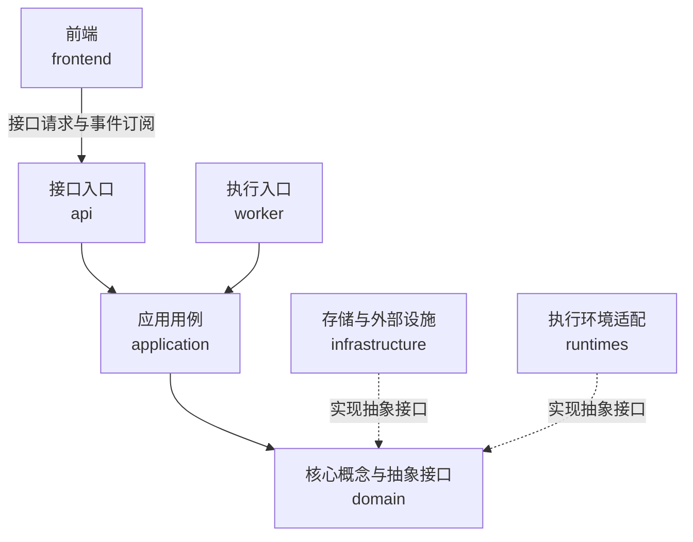

# 工程结构与模块边界

状态：工程骨架说明；未实现具体功能。

## 1. 组织方式

在同一个仓库中维护 TypeScript 前端、Python 后端和设计文档。前后端分别管理工具链；业务概念通过接口和产物契约衔接。

此结构服务于用户配置的 Agent 协作链路。配置、画布、运行详情分别是产品能力，不意味着必须拆成三个后端服务。

## 2. 模块关系

图中箭头表示主要源码依赖方向。应用层在运行时通过抽象接口使用存储和执行能力；具体实现由后续启动组装层注入，不要求领域层依赖这些实现。

启动组装位置在引入实际入口时确定，当前不创建入口文件。

## 3. 前端组织

`frontend/src/features/` 按用户操作划分：

- `configuration/`：配置中心及 Agent 能力设置。
- `workflows/`：画布、节点和协作链路定义。
- `runs/`：运行进度、对话、产物与历史。

`app/` 组织页面，`components/` 承载通用组件，`api/` 封装后端通信，`types/` 放置前端类型及生成类型入口。

## 4. 后端组织

| 目录 | 负责 | 边界 |
| --- | --- | --- |
| `api/` | 输入输出、请求处理与事件接口 | 不直接持有唯一的执行状态 |
| `application/` | 协作启动、状态推进、交接、问答与恢复用例 | 不绑定具体 CLI 或数据库实现 |
| `domain/` | 运行概念、状态规则、产物规则和接口抽象 | 不依赖框架和外部系统 |
| `infrastructure/` | 数据、文件等外部能力实现 | 不重新定义业务概念 |
| `runtimes/` | 对接实际 Agent 执行环境 | 将外部会话和事件映射到统一模型 |
| `worker/` | 任务领取、执行入口和生命周期协调 | 复用应用用例和领域规则 |

已有逻辑架构中的配置管理、交接、人工交互和恢复等职责，后续在应用层与领域层按功能扩展。当前不为每个职责生成空类或额外包。

## 5. 状态与数据边界

- 链路定义可复用；每次执行创建独立 Run。
- Run 固定所用定义版本；NodeRun 和 Attempt 记录节点状态及尝试。
- 正式产物、消息、日志、检查点分别管理。
- 前端展示状态，持久化记录支撑执行推进和恢复。
- 底层会话通过适配器关联，不取代平台运行记录。

具体对象定义参见 [架构与核心概念](../../AsomForge-项目说明与架构设计.md)。

## 6. 当前交付范围

已建立目录、必要说明与占位文件，以及基础忽略和文本格式规则。

尚未生成依赖清单、锁文件、语言模块、页面、接口、数据库结构、迁移、契约 Schema、测试实现或部署脚本。后续应在确定工具链和版本后按任务引入。
