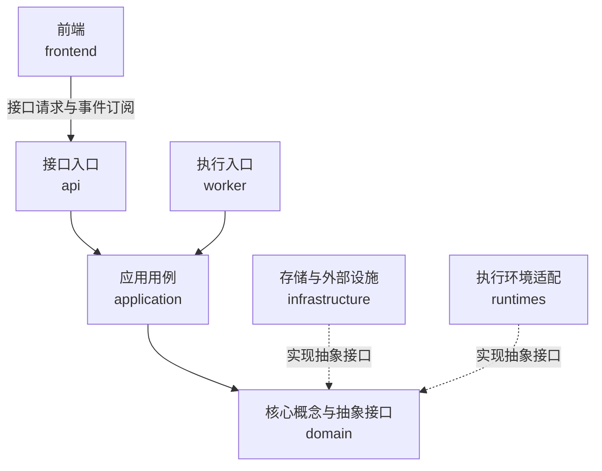

# 工程结构与模块边界

<!-- 说明前后端目录职责、依赖方向和当前实现边界。 -->

状态：配置中心已实现；画布、协作执行与恢复模块仍预留。

## 1. 组织方式

在同一个仓库中维护 TypeScript 前端、Python 后端和设计文档。前后端分别管理工具链；业务概念通过接口和产物契约衔接。

此结构服务于用户配置的 Agent 协作链路。配置、画布、运行详情分别是产品能力，不意味着必须拆成三个后端服务。

产品面向个人本地运行，配置中心与运行界面是两大入口，不建设登录、注册、多用户或租户体系。当前界面、后端和执行层都在本地，配置中心直接使用本地文件；配置中心使用一个本地后端进程；后续执行进程组织另行设计。

## 2. 模块关系

图中箭头表示主要源码依赖方向。应用层在运行时通过抽象接口使用存储和执行能力；具体实现由 main.py 启动组装层注入，不要求领域层依赖这些实现。

当前 main.py 组装配置中心，__main__.py 提供命令入口。

## 3. 前端组织

`frontend/src/features/` 按用户操作划分：

- `configuration/`：Skill、MCP、Prompt、大模型、运行平台配置的管理、导入及适用的校验与可用性测试；Tool 导航预留，暂不实现。
- `workflows/`：画布、节点和协作链路定义。
- `runs/`：运行进度、对话、产物与历史。

`app/` 组织页面，`components/` 承载通用组件，`api/` 封装后端通信，生成接口类型保存在 api/schema.d.ts，types/ 仍预留。

## 4. 后端组织

| 目录 | 负责 | 边界 |
| --- | --- | --- |
| `api/` | 输入输出、请求处理与事件接口 | 不直接持有唯一的执行状态 |
| `application/` | 协作启动、状态推进、交接、问答与恢复用例 | 不绑定具体 CLI 或数据库实现 |
| `domain/` | 运行概念、状态规则、产物规则和接口抽象 | 不依赖框架和外部系统 |
| `infrastructure/` | 数据、文件等外部能力实现 | 不重新定义业务概念 |
| `runtimes/` | 对接实际 Agent 执行环境 | 将外部会话和事件映射到统一模型 |
| `worker/` | 任务领取、执行入口和生命周期协调 | 复用应用用例和领域规则 |

已有逻辑架构中的配置管理、交接、人工交互和恢复等职责，后续在应用层与领域层按功能扩展。当前不为每个职责生成空类或额外包。

## 5. 状态与数据边界

- 链路定义可复用；每次执行创建独立 Run。
- Run 固定所用定义版本；NodeRun 和 Attempt 记录节点状态及尝试。
- 正式产物、消息、日志、检查点分别管理。
- 前端展示状态，持久化记录支撑执行推进和恢复。
- 底层会话通过适配器关联，不取代平台运行记录。
- 配置中心使用 doc/config/ 下的本地文件，private/ 与 logs/ 分别保存私密数据与日志，遵循[本地目录约定](../../doc/README.md)。现有 docs/ 目录继续保存项目文档。
- 后续运行记录、正式产物、工作区和会话数据的组织及恢复方式在对应阶段讨论，当前不引入数据库。

具体对象定义参见 [架构与核心概念](../../AsomForge-项目说明与架构设计.md)。

## 6. 当前交付范围

配置中心前后端、文件仓储、导入、连接检查和对应测试已落地；相关入口和命令见 README。

第一阶段已确定为配置中心闭环：本地配置能够导入、真实保存、修改和重新读取，适用的检查能够反馈明确结果。Tool 只预留导航和目录。后续能力逐段设计、实现和验收，当前目录不表示相关功能已经实现。

已经提供前后端依赖锁文件、OpenAPI 和生成接口类型。画布、执行引擎、数据库、迁移与部署脚本尚未引入。
